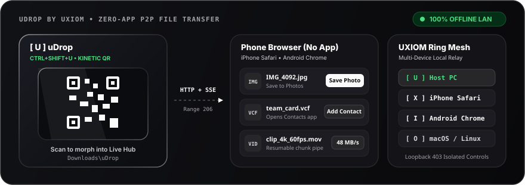

<p align="left">
  <a href="https://github.com/Uxiom">
    <picture>
      <source media="(prefers-color-scheme: dark)" srcset="docs/uxiom-light.svg">
      <source media="(prefers-color-scheme: light)" srcset="docs/uxiom-dark.svg">
      
    </picture>
  </a>
</p>

# uDrop — Zero-Router Cross-Platform P2P File Transfer

[](https://www.npmjs.com/package/@uxiom/udrop)
[](LICENSE)


`uDrop` transfers uncompressed 4K videos, photos, contacts, and archives across **Windows 10/11, iPhone (Safari), Android (Chrome), macOS, and Linux** directly over local Wi-Fi — **with zero cloud uploads, zero accounts, and zero mobile app install**.

<p align="center">
  
</p>

---

## Zero-Friction Install (< 30 Seconds)

### Windows 10 / 11 (No Terminal or Node.js Needed)
1. Download **[uDrop-Setup.exe](https://github.com/Uxiom/udrop/releases/latest/download/uDrop-Setup.exe)** (or **[uDrop-Portable-win64.zip](https://github.com/Uxiom/udrop/releases/latest/download/uDrop-Portable-win64.zip)**) from **[GitHub Releases](https://github.com/Uxiom/udrop/releases/latest)**.
2. Run `uDrop-Setup.exe` (`asInvoker`, no admin UAC required; uninstalls cleanly via Windows Settings or `%LOCALAPPDATA%\uDrop\uninstall.bat`).
3. Click **`[ U ]`** beside your taskbar clock/Wi-Fi icon — or press **`Ctrl + Shift + U`** — to switch uDrop **ON** (**OFF by default** at boot).
4. **Kinetic Liquid Glass QR -> Live Transfer Dashboard**: Particles assemble into the frosted-glass QR code right on screen. Scan it with your phone Camera; once connected, the QR dismantles into the **Live Transfer Overlay Dashboard** with real-time speeds, context-aware file actions, drag-and-drop sharing, and `[X]` unshare controls.
5. **Explorer Right-Click Share**: Right-click any file in Windows Explorer -> **Share via uDrop**.

### macOS / Linux / Cross-Platform (1-Command CLI)
```bash
npx @uxiom/udrop
```
Or install globally (`npm install -g @uxiom/udrop`):
```bash
udrop ./video.mp4 ./contact.vcf    # Share files immediately
udrop --hotspot                    # Direct Windows Wi-Fi hotspot (router-less)
udrop service start                # Run background daemon
udrop service status               # Check running port & URLs
udrop service stop                 # Stop daemon cleanly
```

See **[Hosted Docs](https://uxiom.github.io/udrop/)**, **[SYSTEM_FEATURE_GUIDE.md](SYSTEM_FEATURE_GUIDE.md)**, and **[MANUAL.md](MANUAL.md)** for full workflows.

---

## Context-Aware File Handling

uDrop identifies incoming and shared file types so files go straight to the right place instead of leaving users guessing:
- **Photos (`.jpg`, `.png`, `.heic`, `.webp`)**: Displays live inline thumbnails and **`Save Photo`** (opens native iOS/Android Share Sheet for *Save to Photos* on mobile; **`View`** opens Windows Photos on PC alongside **`Dir`** to locate in `Downloads\uDrop`).
- **4K Videos (`.mp4`, `.mov`, `.webm`)**: Adaptive single-pipe or resumable chunk streaming with **`Save Video`** / native player (`Play` + `Dir` on Windows).
- **Contact Cards (`.vcf`)**: Served with `text/vcard; charset=utf-8` so **`Add Contact`** triggers iOS/Android's native Contacts import sheet directly (**`Import`** on Windows).
- **PDFs & Audio**: Inline **`Preview`** / **`Play`** support alongside **`Download`**, while `.svg`/script formats stay locked to `attachment` for XSS safety.

---

## Security, Privacy & Threat Model

- **100% Local-Only Routing**: Discovery binds only to your local network interface via mDNS (`http://<host>.local:4040`) or direct LAN IPv4 (`http://<ip>:4040`). Zero files or metadata ever leave your LAN.
- **Honest Transport Scope**: Transfers use plain LAN **HTTP** protected by your router's **Wi-Fi encryption (WPA2/WPA3)**—there is no app-layer TLS or per-session pairing PIN yet. Do **not** share sensitive files on open/untrusted public Wi-Fi; use **`udrop --hotspot`** (Windows Hosted Network) or a trusted hotspot instead.
- **Loopback Host Boundary (`403 Forbidden`)**: Control endpoints (`/api/outbound/register`, `DELETE /api/outbound/:id`, `/api/open-folder`, `/api/open-file`, `/api/qr/popup`, `/api/shutdown`) reject any non-loopback socket (`403 Forbidden`), preventing LAN devices from adding/removing host shares, browsing outside `Downloads/uDrop`, or stopping the server.
- **Safe Header & File Handling**: `path.basename()` sanitization + download-root bounds checks prevent path traversal; `Content-Disposition` quotes/CRLF are sanitized; executable/SVG downloads are never served inline.
- **Least-Privilege Windows Packaging**: Compiled with `asInvoker` manifest (no UAC admin elevation) and `HKCU`-only registry keys.

---

## OS Quirks, Permissions & Firewalls

- **Windows 10 / 11**:
  - **SmartScreen**: Release EXEs are currently unsigned (`asInvoker` without paid Authenticode cert). If Defender SmartScreen warns on first launch, click **More info -> Run anyway**, or build/run from source.
  - **Defender Firewall**: Set your Wi-Fi network to **Private** (`Settings -> Network & internet -> Properties`) and click **Allow access** when prompted for Node.js / TCP `4040`.
- **iPhone / iOS (Safari)**:
  - Tap **Allow** on the iOS *Local Network* prompt if requested. Disable *iCloud Private Relay* or cellular fallback if `.local` fails.
  - Downloaded archives/documents save to **Files -> Downloads**; use **Save Photo** / **Add Contact** on images and `.vcf` cards for Photos/Contacts integration.
- **Android (Chrome)**:
  - Some Android builds/routers cannot resolve `.local` hostnames: click **`Use IP`** on the Glass QR Overlay to encode direct LAN IPv4 (`http://192.168.x.x:4040`).
  - Keep screen awake or exempt Chrome from strict battery optimization during multi-gigabyte uploads (uDrop includes a client wake-lock anchor automatically).
- **macOS**:
  - Approve **System Settings -> Privacy & Security -> Local Network** for your Terminal/Node runtime if incoming phone connections fail.
- **Linux**:
  - Install/enable `avahi-daemon` if `.local` mDNS fails, and allow TCP `4040` in your firewall (`sudo ufw allow 4040/tcp`).

---

## Network Protocol & Developer Integration

### Wire Protocol Specification (`PROTOCOL.md`)
Want to implement a native iOS, Android, Rust, Go, or CLI client compatible with uDrop?
Read **[PROTOCOL.md](PROTOCOL.md)** for the full HTTP/1.1, SSE (`GET /api/mesh/events`), UXIOM 5-slot ring (`U/X/I/O/M`), chunked direct-offset upload (`POST /api/upload/init` -> `PUT /chunk/:id/:idx` -> `POST /complete`), HTTP `Range: bytes=` (`206 Partial Content`) download, and `403` loopback boundary specification.

### Programmatic ESM Package (`@uxiom/udrop`)
```bash
npm install @uxiom/udrop
```
Subpath exports:
- `@uxiom/udrop` -> HTTP + SSE engine (`startServer`)
- `@uxiom/udrop/transfer` -> Sparse offset uploads & outbound registry (`initUploadSession`, `writeChunk`, `finalizeUpload`, `cancelUploadSession`, `closeAllSessions`, `registerOutboundFile`, `unregisterOutboundFile`, `getOutboundFiles`, `getDownloadDirectory`)
- `@uxiom/udrop/mesh` -> 5-node ring coordination & SSE (`registerMeshNode`, `unregisterMeshNode`, `pruneStaleNodes`, `getMeshRing`, `dispatchMeshTransfer`, `broadcastHostTransferEvent`)
- `@uxiom/udrop/context` -> Extension-to-MIME & UI category mapping (`getFileContextMeta`)
- `@uxiom/udrop/network` -> LAN IPv4 & mDNS resolution (`getLocalIpAddresses`, `getLocalHostInfo`)
- `@uxiom/udrop/qr` -> Vector QR SVG card generator (`generateSleekQrSvg`)
- `@uxiom/udrop/daemon` -> Background daemon lifecycle (`startDaemon`, `stopDaemon`, `getDaemonStatus`, `installAutoStart`, `uninstallAutoStart`)

```js
import { startServer } from '@uxiom/udrop';
import { registerOutboundFile, getDownloadDirectory } from '@uxiom/udrop/transfer';
import { getLocalHostInfo } from '@uxiom/udrop/network';

await startServer({
  port: 4040,
  onUploadComplete: (result) => console.log('Saved:', result.filePath)
});

registerOutboundFile('./sample.zip');
console.log('Downloads:', getDownloadDirectory());
console.log('Connect URLs:', getLocalHostInfo(4040));
```

---

## Prerequisites & Local Build (< 2 Minutes)

**Prerequisites:**
- **Node.js `>= 18`** (uses native `fetch`; `Node 20 LTS` recommended)
- **Windows only (for native tray & setup `.exe` builds):** Built-in **.NET Framework 4.8** (`C:\Windows\Microsoft.NET\Framework64\v4.0.30319\csc.exe`, preinstalled on Windows 10/11 — no Visual Studio required)

```bash
git clone https://github.com/Uxiom/udrop.git
cd udrop
npm install

# Run engine immediately in dev mode (Linux / macOS / Windows)
npm start

# Run cross-platform core, mesh, context, and daemon test suite
npm test

# Windows-only: rebuild embedded assets, dist/udrop.exe, and dist/udrop-setup.exe
npm run build:win

# Windows-only: run native Windows executable verification
npm run test:win
```

---

## Support & License

- **Creator & Maintainer**: [@vd1686](https://github.com/vd1686) ([Uxiom](https://github.com/Uxiom))
- **Email Support & Commercial Licensing**: [uxiom.support@gmail.com](mailto:uxiom.support@gmail.com)
- **GitHub Issues**: [https://github.com/Uxiom/udrop/issues](https://github.com/Uxiom/udrop/issues)
- **Open-Source License**: **GNU General Public License v3.0 (`GPL-3.0-only`)** — see [LICENSE](LICENSE) (`Copyright (c) 2026 Uxiom`). Distributed derivatives or applications incorporating uDrop code must also be released under GPL v3.0.
- **Commercial / Closed-Source Exception**: Organizations wishing to embed uDrop or parts of uDrop inside proprietary commercial software without releasing source under GPL v3.0 can inquire about a commercial license at **[uxiom.support@gmail.com](mailto:uxiom.support@gmail.com)**.
